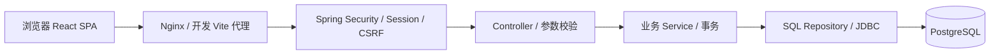

# 图书借阅系统技术选型与架构设计

版本：v2.0（Java 实现）  
日期：2026-10-12  
项目路径：`/Users/yj/Desktop/project/library-system`

## 1. 当前选型

采用 React 单页前端和 Java 模块化单体 API，通过同源 HTTP 接口访问 PostgreSQL。需求与业务表沿用原设计，Java 方案替代初始 Fastify 方案。

| 部分 | 实际实现 |
| --- | --- |
| 前端 | React / React DOM 19.3.0、TypeScript 5.9.3、Vite 8.3.4 |
| 路由与数据 | React Router 7.18.4、TanStack Query 5.104.2、原生 fetch |
| 界面 | Ant Design 6.6.5、中文语言配置、Ant Design Form |
| 后端 | Java 21、Spring Boot 4.1.1、Spring MVC |
| 认证 | Spring Security，数据库 Session、HttpOnly Cookie、CSRF 与 Origin 校验 |
| SQL | Spring JDBC、NamedParameterJdbcTemplate，显式参数化 SQL |
| 事务 | @Transactional、TransactionTemplate，由 Spring 绑定事务连接 |
| 数据库 | PostgreSQL 16；本机检查版本 16.14，部署镜像规划 16.15 |
| 迁移 | Flyway，启动读取 resources/db/migration；prod 禁止自动迁移 |
| 接口文档 | springdoc-openapi 3.1.1，管理员可读取 OpenAPI 和 Swagger UI |
| 构建 | Maven Wrapper，前端 npm 锁文件，Java 依赖由 Boot BOM 管理 |
| 测试 | JUnit、真实 PostgreSQL、Java HttpClient、Playwright 浏览器验证 |
| 日志 | Spring Boot 日志，请求关联 ID，错误响应不暴露内部 SQL |
| 部署 | Compose 管理 api + postgres，已有 Nginx 服务静态资源及代理 |

后端参数使用 Jakarta Bean Validation；异常由统一 Advice 转换。密码使用 Spring Security 的版本标识 PBKDF2 编码器，不保存明文。会话有效期 8 小时，改密、停用和重置撤销会话。

Spring Boot 4.1.1 支持 Java 21；JDBC 与事务机制由 Spring 提供。[Spring Boot 环境要求](https://docs.spring.io/spring-boot/system-requirements.html)、[Spring JDBC](https://docs.spring.io/spring-framework/reference/data-access/jdbc/core.html)、[Spring 事务](https://docs.spring.io/spring-framework/reference/data-access/transaction.html)。

## 2. 总体结构



开发 web 监听 127.0.0.1:5173，api 监听 127.0.0.1:3001，独立本机数据库 127.0.0.1:55432。浏览器通过 localhost:5173 打开，API 请求走 /api，默认 Origin 必须匹配 localhost:5173。

## 3. 目录与职责

```text
apps/web/src/app/           路由、登录状态、角色布局
apps/web/src/features/      auth / catalog / readers / circulation / loans / dashboard
apps/web/src/shared/        apiClient、公开接口类型、反馈与请求操作
apps/api/src/main/java/com/example/library/
  auth/                     安全链、会话过滤器、来源校验、登录及改密
  catalog/                  分类、书目、副本
  readers/                  读者资料和账号管理
  circulation/              借还、续借、幂等与借阅查询
  statistics/               概览、趋势、热门图书
  common/                   SQL、异常、健康、OpenAPI、初始化
apps/api/src/main/resources/db/migration/  Flyway SQL
apps/api/src/test/            集成测试
scripts/                     开发数据库、测试、初始化、备份和恢复
```

Controller 定义公开请求 DTO 和路由；Service 校验权限、业务资格并界定事务；Sql Repository 负责参数化执行、分页、时间输出与简单结果转换。复杂业务 SQL 保留在其 Service 中，便于阅读事务的执行顺序；后续业务增长时可按模块拆分专用 Repository。

Java DTO 与前端 TypeScript 不共享源码。正式接口通过 /v3/api-docs 对照；当前前端类型由 shared/types.ts 维护。后台 Map 查询响应的结构仍需与前端类型及接口例子保持一致，后续可逐步替换为显式响应 DTO。

## 4. 前端页面

| 页面 | 当前路由 | 角色 |
| --- | --- | --- |
| 登录 / 改密 | /login、/change-password | 未登录 / 已登录 |
| 概览 | / | 管理员，读者重定向书目 |
| 书目、详情、录入、归档 | /books | 浏览共用，管理操作限管理员 |
| 馆藏副本 | /copies | 管理员 |
| 分类管理 | /categories | 管理员 |
| 读者资料及历史 | /readers | 管理员 |
| 借还工作台 | /circulation | 管理员 |
| 借阅记录 / 我的借阅 | /loans | 按角色查询不同范围 |

页面采用按模块延迟加载，查询按条件及页码缓存，操作成功后刷新相关数据。账号切换清空缓存，不使用 localStorage 保存认证信息。核心借还不乐观更新，不自动反复提交；网络失败重试同一业务操作保留幂等键。

当前搜索与分页状态保留在页面本地，刷新会重置，尚未将全部筛选同步到 URL。这是实现细节与初始架构规划的差异，不影响基础查询。

## 5. 认证与权限

登录生成随机令牌，浏览器 HttpOnly Cookie 持有原值；数据库只存 SHA-256 摘要。会话过滤器每次确认账号启用、会话未过期，构建 Spring Security 当前用户。

匿名仅可访问登录、CSRF 和最小健康检查。首次改密账号只可访问 auth 路由。管理员操作在 Service 再次确认角色；读者借阅查询和续借通过当前身份限定归属。

前端写操作先读取 /auth/csrf，再以 X-XSRF-TOKEN 提交。Spring Security 校验 HttpOnly CSRF Cookie；来源过滤器拒绝其他 Origin。无 Origin 的非浏览器工具仍需通过 CSRF 校验。生产 Cookie 为 Secure，服务必须通过 HTTPS 访问。[Spring Security CSRF](https://docs.spring.io/spring-security/reference/servlet/exploits/csrf.html)。

登录每个 API 实例按来源 IP 每分钟最多 10 次；当前单实例适用。Nginx 代理时后端默认看到代理地址，限速可能共享额度，部署后需通过明确的可信代理配置设计来源识别，不能盲目信任 X-Forwarded-For。

密码初始化和管理员重置通过终端无回显输入，注入短期进程环境；不在源码文件或命令参数保存密码。读者初始密码由管理员在表单设置，首次登录必须改密。初始化、重置和改密统一校验 5～128 个字符，终端和页面提示保持一致。

## 6. API 约定

基础前缀为 /api/v1。完整路由由 OpenAPI 读取；主要接口如下。

| 模块 | 路由 |
| --- | --- |
| auth | GET /auth/csrf、/auth/me；POST /auth/login、/logout、/password |
| catalog | GET /books、/books/:id；POST /books；PATCH /books/:id；POST /books/:id/archive、restore |
| categories | GET/POST /categories；PATCH/DELETE /categories/:id |
| copies | GET /copies；POST /books/:id/copies；PATCH /copies/:id |
| readers | GET /readers、/readers/:id；POST /readers；PATCH /readers/:id；POST disable、enable、reset-password |
| circulation | POST /loans；POST /loans/:id/return、renew；GET /loans、/me/loans |
| statistics | GET /statistics/overview、trend、popular-books |
| health | GET /health/live、/health/ready |

写请求 JSON 校验拒绝未知字段，日期范围和分页参数校验。分页为 page/pageSize，默认 20，可选 50；响应 items/total/page/pageSize。JSON 字段 camelCase，实体 UUID 字符串，事件 ISO 8601 UTC，应还日期 YYYY-MM-DD。

错误为 `{error:{code,message,requestId}}`，参数 400、未认证 401、权限或 CSRF 403、缺失 404、业务冲突 409、限速 429、内部失败 500。错误只记录异常类型与关联 ID，不打印 SQL 参数。安全链前段产生的错误可能尚未获得业务 requestId，显示 unknown。

注销副本由 PATCH /copies/:id 的 status=retired 执行，与最初单独 /retire 规划不同；副本 identity 由数据库触发器保护。

## 7. 数据库与事务

[数据库设计](图书借阅系统数据库设计.md)定义业务表和锁顺序，真实实现见 V1__initial_schema.sql。Flyway 使用 flyway_schema_history 替代初始方案的自建 schema_migrations。

使用部分唯一索引保护同册未还唯一性；延迟约束触发器在 COMMIT 检查副本与借阅一致。流通写入顺序为幂等键、目标用户、读者、书目、副本、既有借阅；目标用户与读者采用 FOR NO KEY UPDATE，书目 FOR SHARE，副本和借阅 FOR UPDATE。

同读者借出先取得锁，再数未还及逾期，防止超过 5 册。归档书目取得独占行锁并检查未还；停用与流通锁定目标用户协调。借、还、续借使用同一数据库事务，失败不提交幂等结果。

当前使用 Spring 默认 READ COMMITTED。锁/查询超时可由数据库或运行配置进一步收敛；暂未在 JDBC 连接中设置最初规划的 5 秒锁超时/10 秒语句超时。连接池上限 5，连接等待上限 5 秒。

## 8. 迁移与构建

`npm run build` 生成前端 dist 与 Java 可执行 JAR；Maven Wrapper 和 npm 锁文件用于重现依赖。开发自动应用新迁移，prod 关闭自动应用，发布流程单独运行迁移进程。

初始化管理员与演示数据通过无 web 模式启动 Java 进程；管理员重复初始化拒绝，seed 不清空数据。源码迁移已应用后禁止修改，未来变更新增 V2 等文件。

生产迁移目前使用非超级用户 library_app，角色拥有本项目数据库/表结构，便于第一版交付；运行角色与迁移角色尚未进一步拆分，后续可细化 DDL 权限。

## 9. 部署与回退

本次仅在本机创建项目，无阿里云部署操作。Compose 提供 api 和独立 PostgreSQL 服务，不发布数据库端口；API 宿主机端口只绑定 127.0.0.1，由已有 Nginx 代理。

部署需先在工作区外创建两个不同的秘密文件，分别提供 owner_db_password 和 app_db_password，然后以环境变量传递文件路径及 HTTPS APP_ORIGIN。不要在 Compose 或 Git 保存密码。

建议发布顺序：

1. 检查服务器资源、端口、域名与宝塔管理配置，备份相关配置及数据。
2. 构建前端和 Java JAR，构建版本化 API 镜像。
3. 用 `docker compose -f deploy/compose.yml up -d postgres` 创建独立数据库。
4. 用 `docker compose -f deploy/compose.yml run --rm -e SPRING_FLYWAY_ENABLED=true api --spring.main.web-application-type=none` 执行迁移。
5. 以安全输入提供 ADMIN_USERNAME/ADMIN_PASSWORD，单独无 web 模式初始化管理员，不通过命令参数传密码。
6. 发布静态文件并配置 HTTPS 与 /api 代理，启动 api，检查健康与借阅业务。

Docker/Compose 示例此次未实际运行；Nginx 文件为站点片段，尚需 HTTPS 配置，不应直接替换宝塔已有配置。

回退应用时恢复上一版静态文件和镜像；数据库迁移需独立评估，不能依赖镜像回滚。删除容器不等于删除命名卷，不使用 down -v 作为常规回退方法。

## 10. 验证与后续范围

实际验证结果见 [验证记录](验证记录.md)。需求 P0 的基础管理和完整流通流程已实现；P1/P2 保留后续范围。前端 lint、自动生成 TS 类型、运行/迁移角色细分与服务器部署尚未完成，不把这些规划写作现有能力。
