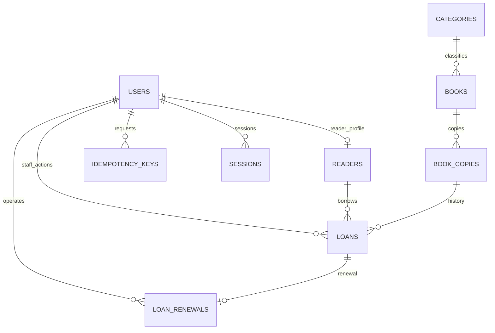

# 图书借阅系统数据库设计

版本：v1.0  
编写日期：2026-10-12  
数据库：PostgreSQL 16.x  
依据：[需求文档](./图书借阅系统需求文档.md)、[技术选型与架构设计](./图书借阅系统技术选型与架构设计.md)

## 1. 设计范围与约定

第一版面向一个图书室，包含管理员、读者、分类、书目、馆藏副本、借阅和续借。辅助存储会话、写请求幂等结果和迁移版本。

本文定义字段、关系、约束、索引和事务规则。完整初始迁移已实现于 `apps/api/src/main/resources/db/migration/V1__initial_schema.sql`，已在独立 PostgreSQL 16 测试环境执行。下文 SQL 片段仍用于解释设计。

- 表与字段采用 snake_case，实体主键为 uuid，默认由数据库生成。
- 事件时间用 timestamptz，数据库会话默认 UTC；应还日期用 date。
- 借阅日期与逾期计算使用 Asia/Shanghai，保持需求约定。
- 数量、逾期状态从事实记录计算，不重复存储可借数量或当前未还计数。
- 用户停用、图书归档、副本注销保留资料与历史；分类仅在无人引用时删除。
- 外键默认限制删除，sessions 的账号外键可级联清理；不存在级联删除借阅历史的入口。

## 2. 实体关系



管理员没有 readers 资料；每个读者账号恰有一条 readers 资料。副本可以有多次历史借阅，但同一时刻只能有一条未归还记录。第一版每笔借阅最多一条续借记录。

## 3. 核心业务表

### 3.1 users：登录账号

| 字段 | 类型 | 约束或用途 |
| --- | --- | --- |
| id | uuid | 主键 |
| username | varchar(32) | 非空，3～32 位英文字母、数字或下划线 |
| username_key | text | generated lower(username)，唯一，英文大小写不区分 |
| password_hash | text | 非空，算法标识、成本参数、盐及派生哈希，非明文密码 |
| role | text | 非空，admin / reader |
| enabled | boolean | 非空，默认 true |
| must_change_password | boolean | 非空，读者初始化和重置时为 true |
| created_at / updated_at | timestamptz | 非空，默认 now()；更新时间由统一触发器更新 |

没有可公开读取密码哈希的 DTO。账号角色修改不属于第一版页面能力。

### 3.2 readers：读者资料

| 字段 | 类型 | 约束或用途 |
| --- | --- | --- |
| id | uuid | 主键 |
| user_id | uuid | 非空、唯一，外键 users |
| code | text | 非空、唯一，序列生成，例如 R00000001 |
| name | varchar(50) | 非空，去除首尾空白后 1～50 字符 |
| phone | varchar(30) | 可空，不要求身份证号 |
| note | varchar(500) | 非空，默认空字符串 |
| created_at / updated_at | timestamptz | 非空 |

启用状态以 users.enabled 为准，不在 readers 重复存储。读者创建时，账号和资料在同一事务中写入。编号使用 sequence，不使用 `MAX(code)+1`，不重复利用；允许编号有间隔。

### 3.3 categories：单层分类

| 字段 | 类型 | 约束或用途 |
| --- | --- | --- |
| id | uuid | 主键 |
| name | varchar(30) | 非空，去首尾空白后 1～30 字符；保存规范化后的显示值 |
| name_key | text | generated lower(btrim(name))，唯一 |
| created_at / updated_at | timestamptz | 非空 |

books 的分类外键使用 ON DELETE RESTRICT；归档书目仍占用分类关系。

### 3.4 books：书目与版本

| 字段 | 类型 | 约束或用途 |
| --- | --- | --- |
| id | uuid | 主键 |
| category_id | uuid | 非空，外键 categories |
| title / author | varchar(200) | 非空，去首尾空白后 1～200 字符 |
| publisher | varchar(200) | 可空 |
| isbn | varchar(13) | 可空；保存通过校验的规范化 ISBN-13，非空时唯一 |
| publication_year | smallint | 可空，1～9999 |
| edition | varchar(200) | 可空，版本说明 |
| description | varchar(2000) | 非空，默认空字符串 |
| archived_at | timestamptz | 可空，非空表示归档 |
| created_at / updated_at | timestamptz | 非空 |

ISBN 处理：去掉空格和连字符，ISBN-10 校验后转为等价 ISBN-13；ISBN-13 校验格式及校验位，入库前统一形式。数据库 CHECK 对最终 ISBN-13 再校验；未提供 ISBN 存 NULL，不存空字符串。相同版本的两种 ISBN 表示因此不会重复建档。

书名不设置唯一约束，避免同名不同版本无法录入。作者暂以文本保存，不引入作者表与关联表。归档要求没有未归还记录；归档与副本状态分别存储，恢复不修改副本状态。

### 3.5 book_copies：实体副本

| 字段 | 类型 | 约束或用途 |
| --- | --- | --- |
| id | uuid | 主键 |
| book_id | uuid | 非空，外键 books |
| code | text | 非空、唯一，sequence 生成，例如 LIB00000001 |
| location | varchar(100) | 非空，默认空字符串 |
| status | text | available / borrowed / unavailable / retired，默认 available |
| status_reason | varchar(500) | 不可借或注销时必填非空白原因 |
| note | varchar(500) | 非空，默认空字符串 |
| created_at / updated_at | timestamptz | 非空 |

副本编号与 ISBN 不同：一版图书共用 ISBN，每册副本的 code 独立。已有借阅历史后，book_id 与 code 不可修改；第一版可直接将二者始终视为不可变字段。

状态变化：available → borrowed → available；破损归还变 unavailable；available 与 unavailable 可维护切换；无未还记录时可转 retired，第一版不可恢复。

### 3.6 loans：借阅事实

| 字段 | 类型 | 约束或用途 |
| --- | --- | --- |
| id | uuid | 主键 |
| reader_id | uuid | 非空，外键 readers |
| copy_id | uuid | 非空，外键 book_copies |
| borrowed_at | timestamptz | 非空，后端确定 |
| original_due_date | date | 非空，初始应还日期，之后不可改 |
| due_date | date | 非空，当前应还日期，可按续借规则延长 |
| returned_at | timestamptz | 可空，NULL 表示未归还 |
| borrowed_by | uuid | 非空，外键 users，经办管理员 |
| returned_by | uuid | 可空，外键 users，归还经办管理员 |
| borrow_days | smallint | 非空，政策快照，默认 30，必须大于 0 |
| renewal_days | smallint | 非空，政策快照，默认 30，必须大于 0 |
| max_renewals | smallint | 非空，第一版为 1 |
| note / return_note | varchar(500) | 非空，默认空字符串 |
| created_at / updated_at | timestamptz | 非空 |

CHECK 约束：归还时间不得早于借出时间；returned_at 与 returned_by 同为空或同为非空；初始应还日期不早于借出本地日期；due_date 不早于 original_due_date。

reader_id、copy_id、borrowed_at、original_due_date、borrowed_by 和政策快照在借出后不可变；归还后不能重新打开或续借。使用数据库触发器保护这些历史事实，不向普通接口提供删除能力。

当前逾期为“returned_at IS NULL 且 due_date 小于今天”；逾期归还以归还本地日期计算。原借出日期保留，续借不算新借阅。

### 3.7 loan_renewals：续借记录

| 字段 | 类型 | 约束或用途 |
| --- | --- | --- |
| id | uuid | 主键 |
| loan_id | uuid | 非空、唯一，外键 loans；第一版每条借阅至多续借一次 |
| operated_by | uuid | 非空，外键 users，管理员或该读者账号 |
| operated_at | timestamptz | 非空，后端确定 |
| old_due_date / new_due_date | date | 非空，新日期必须晚于旧日期 |

续借与 loans.due_date 更新在同一事务中提交；新日期必须为旧日期加该借阅的 renewal_days。后续增加多次续借，需要新迁移与新的次数约束，不能只改配置。

## 4. 辅助表

| 表 | 字段与规则 |
| --- | --- |
| sessions | token_hash char(64) 主键、user_id 外键、expires_at、created_at；存随机令牌的 SHA-256 摘要，原令牌只进入 HttpOnly Cookie |
| idempotency_keys | actor_id、operation、key UUID 为复合主键；request_hash char(64)、response JSONB、created_at；operation 为 borrow / return / renew |
| flyway_schema_history | 由 Flyway 管理版本、校验和、执行记录，替代原规划的 schema_migrations |

幂等记录仅在请求处理中允许 response 暂为空；成功提交时必须包含结果。失败随事务回滚，不能留下“处理中”的已提交占位记录。借阅业务参数规范化后计算摘要，同键不同摘要返回 409。会话过期记录按计划清理；第一版保留幂等历史，不直接设置短 TTL。

## 5. 索引设计

主键及 UNIQUE 已创建对应索引，避免再创建重复普通索引。外键本身不会自动建立引用端的索引，按查询与维护需求添加。

| 索引 | 用途 |
| --- | --- |
| loans(copy_id) WHERE returned_at IS NULL，UNIQUE | 同册最多一条未归还记录 |
| loans(reader_id, due_date) WHERE returned_at IS NULL | 读者未还数量、是否存在逾期 |
| loans(reader_id, borrowed_at DESC, id DESC) | 我的借阅、读者历史 |
| loans(borrowed_at DESC, id DESC) | 全部借阅分页与借出趋势 |
| loans(due_date, id) WHERE returned_at IS NULL | 当前逾期和即将到期 |
| loans(copy_id, borrowed_at DESC) | 副本历史与外键维护 |
| loans(borrowed_by)、loans(returned_by) | 经办人外键查询及维护 |
| books(category_id, created_at DESC, id DESC) | 分类筛选及外键维护 |
| books(created_at DESC, id DESC) WHERE archived_at IS NULL | 正常书目列表 |
| book_copies(book_id, status) | 馆藏统计、状态与图书关系 |
| sessions(user_id)、sessions(expires_at) | 撤销用户全部会话、清理过期会话 |
| loan_renewals(operated_by) | 操作人外键维护 |

核心约束示例：

```sql
CREATE UNIQUE INDEX loans_one_active_copy
ON loans(copy_id)
WHERE returned_at IS NULL;
```

该索引限制当前借阅，不限制同册历史记录数量。[PostgreSQL 部分唯一索引](https://www.postgresql.org/docs/16/indexes-partial.html)。

包含匹配采用参数化 ILIKE，并转义用户通配符输入。普通 B-tree 不用于宣称任意 `%关键词%` 检索有索引加速；完成测量后可加入 pg_trgm 的 GIN 索引。它改善相应文本匹配，不提供图片识别、中文分词或语义搜索。[pg_trgm 文档](https://www.postgresql.org/docs/16/pgtrgm.html)。

## 6. 数据库约束与服务层分工

| 规则 | 数据库保障 | 服务层保障 |
| --- | --- | --- |
| ID、外键、用户名、编号、ISBN 唯一 | 主键、外键、UNIQUE、CHECK | 规范化和友好错误 |
| 同册最多一笔未还 | 部分唯一索引 | 锁副本，检查状态，冲突提示 |
| 借阅与副本状态一致 | 延迟约束触发器在事务提交时核对 | 同事务创建/归还记录和更新副本 |
| 读者最多 5 册、无逾期可新借 | 不是单行 CHECK 能完成的规则 | 先锁读者，再查询和判断 |
| 经办人角色与数据归属 | 外键保证对象存在 | 认证、角色校验、限制自己的借阅 |
| 每笔借阅续借一次 | loan_id 唯一、日期 CHECK | 资格判断、同事务改日期 |
| 初始期限与政策快照 | 字段 CHECK、事实不可变触发器 | 计算期限、限制客户端输入 |
| 图书归档和账号停用与借阅交错 | 使用协调的行锁 | 归档前检查、停用阻止新借/续借 |

延迟一致性触发器应在 loans 与 book_copies 相关写入后，提交前检查最终结果：borrowed 副本恰有一笔未还，其他状态没有未还。这样允许事务先插借阅再更新副本，不允许只改其中一边。书目、角色与次数规则不应被描述成已经由外键自动保证。

## 7. 事务与锁顺序

隔离级别第一版使用 READ COMMITTED；关键资格检查在取得锁后重新查询。事务只执行数据库操作，不跨越用户确认、外部请求或密码哈希计算。单事务通过 Spring JDBC 使用同一事务绑定连接，不手工另开连接。[Spring 事务](https://docs.spring.io/spring-framework/reference/data-access/transaction.html)、[PostgreSQL 行锁](https://www.postgresql.org/docs/16/explicit-locking.html)。

### 7.1 公共顺序

借、还、续借遵循：**幂等键 → 目标读者 users 行 → readers 行 → books 行 → book_copies 行 → loans 行**。

- 目标 users / readers 使用 FOR NO KEY UPDATE，串行处理同一读者的流通操作，并与停用协调。此锁与外键检查取得的 KEY SHARE 兼容，避免幂等记录先引用账号后，多个请求再升级账号锁造成不必要的死锁。
- books 对正常流通使用 FOR SHARE，归档使用 FOR UPDATE，防止“检查后即归档”。
- 副本、既有借阅使用 FOR UPDATE；借出新记录前副本已有锁。
- 需要涉及多行时按 ID 顺序取得同类锁；临时读取用于确定归属，锁后重新验证。
- 归档只锁书目并检查未还；副本维护先锁书目，再锁副本；停用先锁用户。相关操作不能以相反顺序取锁。
- 身份验证在事务外完成，service 在事务内确认关键账号启用情况；涉及多个账号的管理操作按用户 ID 固定顺序锁定。
- 锁超时或死锁回滚并提示重试，重试同一次请求沿用原幂等键。

### 7.2 借出

1. 校验管理员、参数与幂等键，开始事务。
2. 插入或锁定当前幂等记录；已完成且摘要一致则返回原结果。
3. 按公共顺序锁定目标读者、书目和副本。
4. 确认读者启用、未还少于 5 册、没有逾期，书目未归档、副本可借。
5. 以服务器当前时间计算借出本地日期，应还日期加 30 天，保存政策快照。
6. 插入 loans，将副本设为 borrowed，写入幂等结果。
7. 提交；任一步失败全部回滚。

锁定读者后再计数，保证同时借第 5 和第 6 册时只有一次成功；部分唯一索引进一步保护同册并发。

### 7.3 归还

1. 校验管理员，根据 loan ID 查出读者与副本归属。
2. 开始事务、处理幂等记录，按公共顺序取锁并重新读取借阅。
3. 确认仍未归还；停用读者也允许由管理员归还。
4. 设置 returned_at / returned_by 和备注；正常归还副本变 available，破损归还变 unavailable 并写原因。
5. 保存幂等结果、提交。对同一已完成幂等请求重放成功；不同键办理已经归还的记录返回明确状态冲突。

### 7.4 续借

1. 校验管理员或该借阅所属读者，开始事务、处理幂等记录并取锁。
2. 确认账号启用、借阅未归还、今天不晚于 due_date、没有其他逾期未还、没有续借记录。
3. 新应还日期 = 当前 due_date + renewal_days，更新 loans 并插入 loan_renewals。
4. 保存幂等结果、提交。并发续借由锁和 loan_id 唯一约束保证最多一次。

### 7.5 停用与归档

停用账号取得用户行的 FOR NO KEY UPDATE 锁后设置 enabled=false 并清理 sessions，保留 readers 和 loans。归档图书取得书目独占行锁，确认其副本没有未归还记录后写 archived_at；恢复只清除此时间，不更改副本状态。

## 8. 日期与统计口径

借阅业务的“今天”由数据库统一表达：

```sql
(CURRENT_TIMESTAMP AT TIME ZONE 'Asia/Shanghai')::date
```

2026-09-30 借出，加 30 天后应还日期为 2026-10-30；当天归还不逾期，次日归还逾期 1 天。续借从旧期限加 30 天，不从操作当天重算。

未还逾期天数为 `GREATEST(今天 - due_date, 0)`；已还逾期天数为 `GREATEST(归还本地日期 - due_date, 0)`。即将到期包含今天至今天加 3 天，且尚未归还。

统计约定：

- 正常图书种数排除归档图书；未注销馆藏总数包含归档图书的未注销副本。
- 未注销册数 = available + borrowed + unavailable；retired 不计入。
- 可借数量按副本 available 计算；归档书目即使有 available 副本仍禁止办理新借。
- 每条 loans 算一次借阅，续借不额外计次；历史归还不减少历史借出数量。
- 最近 30 天按本地日期从今天减 29 天到今天，包括整个日期区间；热门书目可包含归档书目并标记。
- 读者姓名和书目信息在历史查询中显示当前资料；第一版不保存这些信息的版本快照，但记录实体关联不变。

## 9. 查询示例

书目及馆藏数量：

```sql
SELECT b.id, b.title, c.name AS category,
       count(bc.id) FILTER (WHERE bc.status <> 'retired') AS total_copies,
       count(bc.id) FILTER (WHERE bc.status = 'available') AS available_copies
FROM books b
JOIN categories c ON c.id = b.category_id
LEFT JOIN book_copies bc ON bc.book_id = b.id
WHERE b.archived_at IS NULL
GROUP BY b.id, c.name
ORDER BY b.created_at DESC, b.id DESC
LIMIT $1 OFFSET $2;
```

读者自己的借阅：

```sql
SELECT l.id, b.title, bc.code, l.borrowed_at, l.due_date, l.returned_at
FROM loans l
JOIN readers r ON r.id = l.reader_id
JOIN book_copies bc ON bc.id = l.copy_id
JOIN books b ON b.id = bc.book_id
WHERE r.user_id = $1
ORDER BY l.borrowed_at DESC, l.id DESC
LIMIT $2 OFFSET $3;
```

这里的 `$1` 必须来自服务端已验证会话，不能信任请求传来的 userId。分页采用固定第二排序键；并发新增时 offset 分页不保证跨页快照一致，第一版在固定数据下验证稳定性，后续需要时引入游标分页。

## 10. 迁移、备份与验证

- 创建独立数据库和应用账号，应用运行账号不授予超级用户权限；建表迁移使用专用迁移身份。
- 首个迁移包含表、序列、函数、触发器和索引；后续变更新增文件，不修改已执行迁移。
- 初始化只使用虚构数据，无默认密码；管理员密码由安全输入在运行时提供。
- 用独立真实 PostgreSQL 测试：外键、ISBN 判重、同册唯一未还、副本一致性、事务回滚、并发超限、并发续借与日期边界。
- 备份使用 PostgreSQL 工具；备份文件可能包含个人资料和密码哈希，保存到受限的工作区外目录，不提交 Git。
- 恢复到独立测试数据库，核对数量、历史、当前未还与副本状态，再验证查询和借还；不直接覆盖运行数据库作为演练。
- 迁移失败事务回滚；已提交迁移的回退另行设计并验证，与切换 API 版本分开处理。

已交付 `V1__initial_schema.sql`、Flyway 执行机制、虚构数据初始化和真实数据库测试。具体结果见[验证记录](验证记录.md)。初始设计的 updated_at/索引与实际 SQL 如有差异，以已应用迁移及后续新增迁移为准；不能直接改动已应用迁移。
